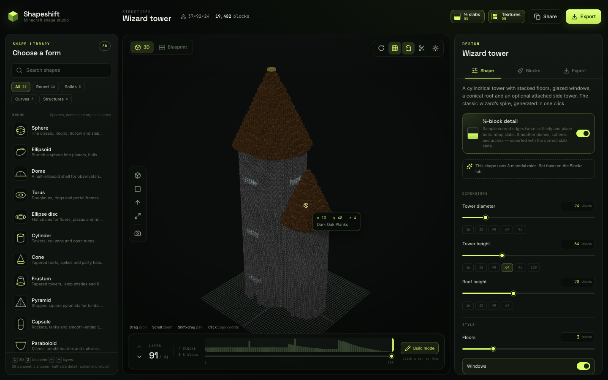

# Shapeshift

A Minecraft shape studio: **36 parametric shapes**, real half-slab geometry, a WebGL voxel viewer, layer-by-layer blueprints and schematic exports.

Built as a modern answer to Plotz / McGic — with the one thing those generators leave out: **slabs**.



## What it does

- **36 shapes** across Round, Solids, Curves and Structures — spheres, ellipsoids, domes, torus, capsules, eggs, hearts, superellipsoids, prisms, stars, gears, arches, helices, Möbius rings, torus knots, observatories, wizard towers, lighthouses, snowmen, igloos, geodesic domes and more.
- **½-block detail**: curved shapes are sampled at twice the vertical resolution and emitted as bottom/top slabs. Materials with a matching slab block use it automatically; slab-less materials fall back to full blocks so exports stay valid.
- **Real-time 3D viewer**: instanced voxel rendering with face shading, orbit/zoom/pan, camera presets, auto-rotate, layer focus, ghosted future layers, a section cut, hover coordinates, click-to-copy and PNG screenshots.
- **Actual Minecraft textures**: toggle the block textures on from the top bar. The 16×16 vanilla textures are composed into a per-face atlas and rendered with nearest-neighbour filtering in both 3D and 2D. Textures are fetched at runtime from a public 1.20.1 asset mirror (jsDelivr / GitHub / mcasset) and are not bundled with the project; if the mirror is unavailable, Shapeshift falls back to its flat colour palette.
- **Blueprint mode**: top-down layer plan with slabs drawn as half-cells, previous-layer ghosting, symmetry badges, quadrant counts, row/column counts, pan/zoom and a layer timeline.
- **Exports**: Litematica (`.litematic`), Sponge v2 (`.schem`), vanilla structure block (`.nbt`), block shopping list CSV, coordinate CSV and blueprint PNG. Slab states are written as `minecraft:*_slab[type=bottom|top]`.
- **Shareable state**: shape, parameters, materials, layer and build origin are encoded in the URL and persisted locally.

All generation and export happens in the browser. No files are uploaded.

## Development

```bash
npm install
npm run dev      # http://127.0.0.1:5181
npm test         # shape + NBT export validation
npm run build    # type-check and production bundle
```

The dev server uses Vite. Generation runs in a Web Worker; the viewer uses Three.js with custom instanced shaders.

## Notes

- Block states target Minecraft **1.20.1** (`DataVersion 3465`).
- Litematic `BlockStates` use YZX order packed LSB-first into longs; `.schem` uses YZX varint indices.
- The default build origin is `0 / 64 / 0`; change it in **Export → Build origin** to match your world. Hover coordinates and the coordinate CSV use it.
- Textures are fetched from a public mirror of the Minecraft 1.20.1 assets at runtime; no Mojang texture files are included in this repository. The texture state is saved in the URL (`tex=1`) and localStorage.
- Slab detail can be toggled from the top bar or the Shape panel. When on, expect more pieces and a smoother silhouette.

Not affiliated with Mojang or Microsoft.
