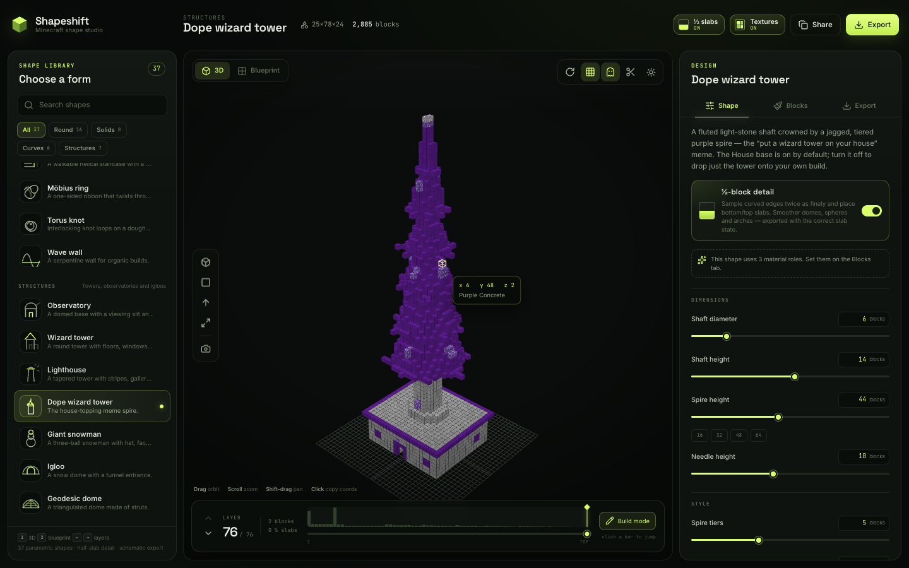

# Shapeshift

A Minecraft shape studio: **37 parametric shapes**, real half-slab geometry, a WebGL voxel viewer, layer-by-layer blueprints and schematic exports.

Built as a modern answer to Plotz / McGic — with the one thing those generators leave out: **slabs**.

**Live:** [shapeshift.mc.zgv2.dev](https://shapeshift.mc.zgv2.dev/)



## What it does

- **37 shapes** across Round, Solids, Curves and Structures — spheres, ellipsoids, domes, torus, capsules, eggs, hearts, superellipsoids, prisms, stars, gears, arches, helices, Möbius rings, torus knots, observatories, wizard towers, lighthouses, snowmen, igloos, geodesic domes and more.
- **½-block detail**: curved shapes are sampled at twice the vertical resolution and emitted as bottom/top slabs. Materials with a matching slab block use it automatically; slab-less materials fall back to full blocks so exports stay valid.
- **Real-time 3D viewer**: instanced voxel rendering with face shading, orbit/zoom/pan, camera presets, auto-rotate, layer focus, ghosted future layers, a section cut, hover coordinates, click-to-copy and PNG screenshots.
- **Actual Minecraft textures**: toggle the block textures on from the top bar. The 16×16 vanilla textures from the latest Java release (Minecraft **26.3**) are composed into a per-face atlas and rendered with nearest-neighbour filtering in both 3D and 2D. Textures are fetched at runtime from a public 26.3 asset mirror (jsDelivr / GitHub / mcasset) and are not bundled with the project; if the mirror is unavailable, Shapeshift falls back to its flat colour palette.
- **Blueprint mode**: top-down layer plan with slabs drawn as half-cells, previous-layer ghosting, symmetry badges, quadrant counts, row/column counts, pan/zoom and a layer timeline.
- **Exports**: Litematica (`.litematic`), Sponge v2 (`.schem`), vanilla structure block (`.nbt`), block shopping list CSV, coordinate CSV and blueprint PNG. Slab states are written as `minecraft:*_slab[type=bottom|top]`.
- **Shareable state**: shape, parameters, materials, layer and build origin are encoded in the URL and persisted locally.
- **Dope wizard tower**: a meme-inspired tiered purple spire with an optional flat-roof house base, so you can recreate the “put a wizard tower on your house” bit. The shaft is fluted light stone; swap the spire material to obsidian for the darker original look.
- **Nine languages**: English, Ukrainian, Simplified Chinese, Traditional Chinese, German, French, Italian, Spanish and Japanese — the same set as [The Enchantment Codex](https://enchantments.mc.zgv2.dev/). Pick a language from the landing header or the studio library footer; the choice persists and follows the browser on first visit.
- **Cross-links**: Shapeshift and the Enchantment Codex link to each other from their landing pages and studios.

All generation and export happens in the browser. No files are uploaded.

## Development

```bash
npm install
npm run dev      # landing: http://127.0.0.1:5181 • studio: http://127.0.0.1:5181/studio/
npm test         # shape, export and SEO validation
npm run build    # type-check + build both static pages
```

The dev server uses Vite. Generation runs in a Web Worker; the viewer uses Three.js with custom instanced shaders. `/` is a static landing page, `/studio/` is the React app, and both are separate Vite entries so the marketing page never ships Three.js.

## Languages

The UI, shape library, shape descriptions, parameter copy and landing page are available in the same nine languages as The Enchantment Codex:

- English
- Ukrainian
- Simplified Chinese
- Traditional Chinese
- German
- French
- Italian
- Spanish
- Japanese

A native language selector lives in the landing header, the studio topbar at wide widths, and the studio library footer. The selection is stored under `shapeshift:language`, is added to shared studio URLs as `lang=…`, and falls back to the browser language on first visit. `src/i18n/` contains the language registry, dictionary and DOM translation layer; block labels use the official Minecraft 26.3 language files.

The long-form copy is a machine-assisted first pass; the UI, shape names and block labels have manual terminology overrides. If you change a source string, add it to `src/i18n/dictionary.json` (or a new generated locale pass) so it does not fall back to English.

## Landing page & SEO

The public site is deliberately split into two static pages:

- **`/`** — a semantic, crawlable landing page with the shape library, feature copy, FAQ and a one-click route into the studio. No React or Three.js on this page.
- **`/studio/`** — the interactive generator, with its own canonical URL and a title that updates to the current shape (for example “Torus Generator — Shapeshift”).

SEO details live in `index.html` and `studio/index.html`: descriptive titles, canonical URLs, `hreflang` alternates for all nine languages, Open Graph and Twitter cards with locale alternates, `SoftwareApplication` / `FAQPage` / `WebSite` JSON-LD, and a 1200×630 `og.png`. `public/robots.txt` and `public/sitemap.xml` point at the production domain, `https://shapeshift.mc.zgv2.dev/`. Old share links that still use `/?shape=…` redirect to the studio automatically.

`npm run build` emits `dist/index.html` plus `dist/studio/index.html`. The landing page's images are pre-sized WebP assets, and its JS is a tiny module just for fonts and the legacy redirect.

## Notes

- Block states in exports target Minecraft **1.20.1** (`DataVersion 3465`) for wide toolchain compatibility. The visual texture preview uses the latest Java release, **26.3**.
- Litematic `BlockStates` use YZX order packed LSB-first into longs; `.schem` uses YZX varint indices.
- The default build origin is `0 / 64 / 0`; change it in **Export → Build origin** to match your world. Hover coordinates and the coordinate CSV use it.
- Textures are fetched from a public mirror of the Minecraft 26.3 assets at runtime; no Mojang texture files are included in this repository. The texture state is saved in the URL (`tex=1`) and localStorage.
- Slab detail can be toggled from the top bar or the Shape panel. When on, expect more pieces and a smoother silhouette.

The **Dope wizard tower** is a nod to [b1tter’s “Put a Wizard Tower on your house” short](https://www.youtube.com/shorts/2i1wnyZ7XAc).

Not affiliated with Mojang or Microsoft.
